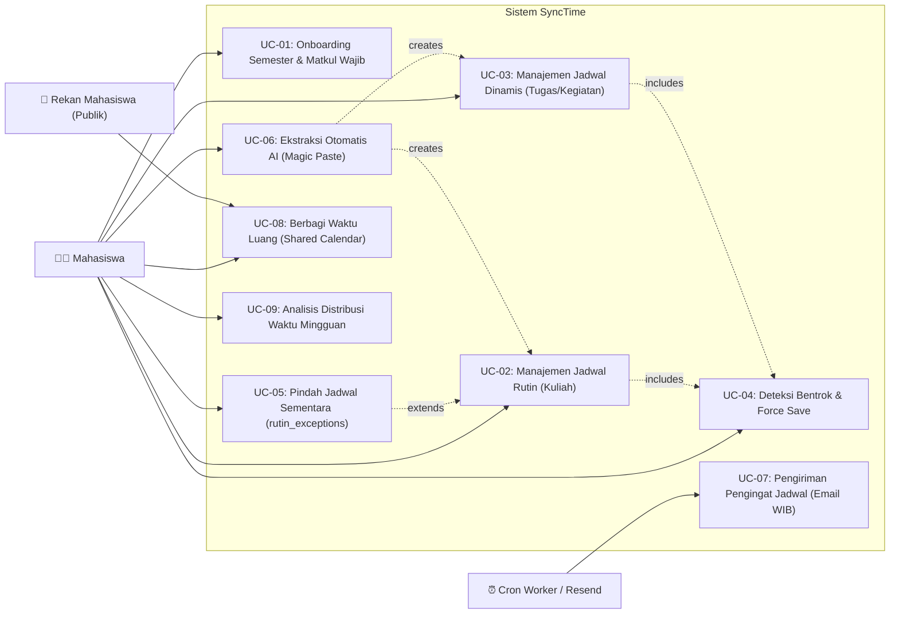
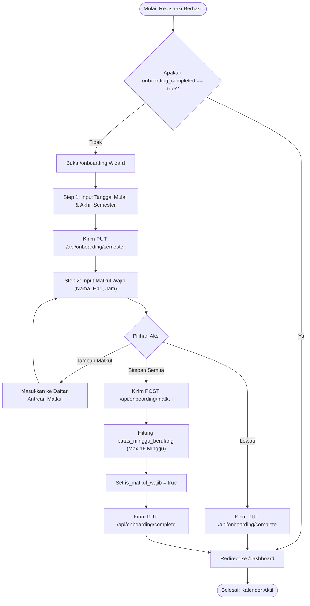
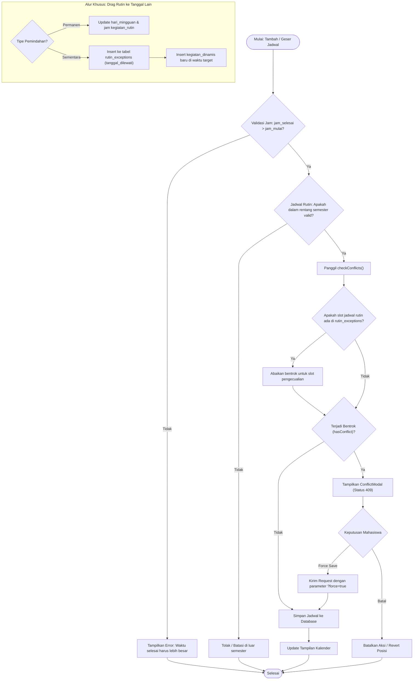
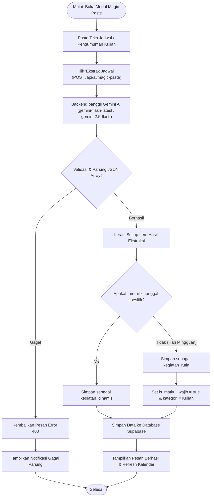
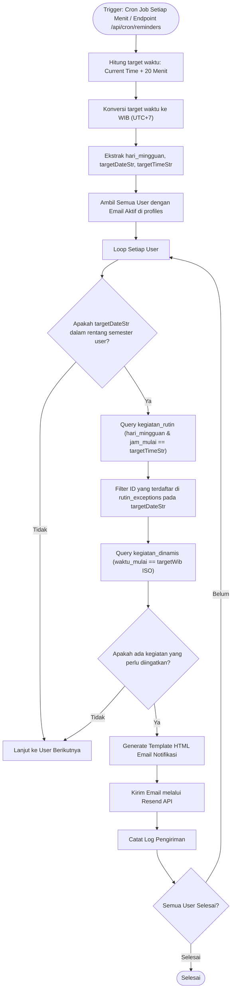
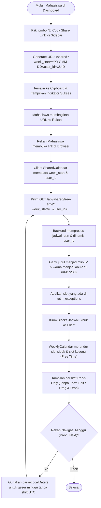

# Dokumentasi Use Case & Activity Diagram — SyncTime

Dokumentasi ini menyajikan arsitektur sistem, pemetaan Use Case Diagram, serta Activity Diagram mendalam untuk seluruh alur bisnis utama platform **SyncTime** dengan persona target pengguna utama: **Mahasiswa**.

---

## 1. Ringkasan Arsitektur Sistem (System Architecture Overview)

SyncTime dirancang untuk membantu mahasiswa mengoptimalkan manajemen waktu, mengintegrasikan jadwal perkuliahan mingguan (rutin) dan agenda tugas/kegiatan insidental (dinamis), memitigasi jadwal yang saling bertabrakan (conflict detection), serta menyediakan integrasi AI (Magic Paste) dan notifikasi otomatis (email reminder berbasis WIB).

```
+-----------------------------------------------------------------------------------+
|                                  CLIENT (SPA)                                     |
|  React 18 + Vite + Tailwind CSS + @dnd-kit (Weekly Drag & Drop Calendar)           |
+-----------------------------------------------------------------------------------+
                                         │
                                         ▼ HTTPS / REST API
+-----------------------------------------------------------------------------------+
|                                SERVER (API BACKEND)                               |
|  Express.js + TypeScript                                                          |
|  - Routes: /api/calendar, /api/rutin, /api/dinamis, /api/shared, /api/ai/magic-paste|
|  - Engine: conflictChecker.ts (Semester Bounds, Week Limits, Exception Filtering) |
|  - Worker: cronJobs.ts (WIB +20 mins Reminders via Resend API)                     |
+-----------------------------------------------------------------------------------+
                                         │
                     ┌───────────────────┴───────────────────┐
                     ▼                                       ▼
+-----------------------------------------+ +---------------------------------------+
|           PERSISTENCE & AUTH            | |            EXTERNAL SERVICES          |
|  Supabase (PostgreSQL 15 + Row Auth)    | |  - Google Gemini AI (2.5 Flash)       |
|  - profiles (semester bounds & status)  | |  - Resend Mail API (Notifikasi Email) |
|  - kegiatan_rutin & kegiatan_dinamis    | |                                       |
|  - rutin_exceptions (reschedule track)  | |                                       |
+-----------------------------------------+ +---------------------------------------+
```

---

## 2. Use Case Diagram (Sistem Manajemen Waktu Mahasiswa)

Diagram berikut memetakan relasi antara 3 aktor utama sistem:
1. **🧑‍🎓 Mahasiswa**: Pengguna utama terotentikasi yang mengatur kalender, jadwal kuliah, tugas, dan preferensi.
2. **⏰ Cron Worker / Resend**: Service background yang memeriksa jadwal aktif dan mendistribusikan notifikasi email.
3. **👥 Rekan Mahasiswa (Publik)**: Pengguna eksternal yang melihat slot ketersediaan waktu luang (free time) tanpa hak edit.



---

## 3. Activity Diagram 1: Onboarding Semester & Matkul Wajib

Diagram ini mengilustrasikan alur mahasiswa baru setelah menyelesaikan otentikasi registrasi hingga masuk ke dashboard kalender mingguan. Alur ini menjamin data semester (`semester_start`, `semester_end`) tersimpan sebelum mahasiswa memasukkan jadwal rutin.



### Penjelasan Bisnis & Komponen Teknis:
- **Komponen Frontend**: `client/src/pages/OnboardingPage.tsx`, `client/src/App.tsx` (Protected Routing & Guard).
- **Endpoint Backend**: `PUT /api/onboarding/semester`, `POST /api/onboarding/matkul`, `PUT /api/onboarding/complete`.
- **Aturan Validasi**:
  * `semester_end` harus lebih besar dari `semester_start`.
  * `jam_selesai` matkul wajib harus lebih besar dari `jam_mulai`.
  * Default `batas_minggu_berulang` disetel maksimal 16 minggu perkuliahan.

---

## 4. Activity Diagram 2: Manajemen Jadwal Rutin & Dinamis (Conflict Detection & `rutin_exceptions`)

Diagram ini mendokumentasikan penambahan atau pemindahan jadwal (via modal form maupun drag-and-drop `@dnd-kit`), evaluasi bentrok waktu (`checkConflicts`), serta mekanisme pemindahan sementara jadwal rutin ke tanggal lain (`rutin_exceptions`).



### Penjelasan Bisnis & Komponen Teknis:
- **Komponen Frontend**: `client/src/components/Calendar/TimeBlock.tsx`, `client/src/hooks/useDragAndDrop.ts`, `client/src/components/Forms/RutinForm.tsx`, `client/src/components/Forms/DinamisForm.tsx`, `client/src/components/Calendar/ConflictModal.tsx`.
- **Endpoint Backend**: `POST /api/rutin`, `PUT /api/rutin/:id`, `POST /api/dinamis`, `PUT /api/dinamis/:id`, `POST /api/calendar/move`.
- **Aturan Bebas Double-Counting**:
  * Ketika kuliah rutin digeser sementara ke tanggal lain, entri dicatat pada `rutin_exceptions`.
  * `/api/analytics` dan `/api/calendar/weekly` mengecualikan slot asli pada tanggal tersebut sehingga durasi jam belajar tidak terhitung ganda.

---

## 5. Activity Diagram 3: Ekstraksi Jadwal AI (Magic Paste)

Diagram ini menggambarkan konversi otomatis pengumuman perkuliahan tidak terstruktur atau pesan obrolan grup WhatsApp dosen/asisten menjadi jadwal terstruktur menggunakan Google Gemini AI.



### Penjelasan Bisnis & Komponen Teknis:
- **Komponen Frontend**: `client/src/components/Forms/MagicPasteBox.tsx`.
- **Endpoint Backend**: `POST /api/ai/magic-paste` (didukung service `server/src/routes/magicPaste.ts`).
- **Aturan Ekstraksi**:
  * Jika teks memuat hari mingguan berulang (misal: "Setiap Senin 08:00 - 10:00"), disimpan sebagai `kegiatan_rutin` dengan flag `is_matkul_wajib: true` dan kategori otomatis dikaitkan ke "Kuliah".
  * Jika teks memuat tanggal kalender spesifik (misal: "Kuis 28 Oktober 2026 13:00 - 15:00"), disimpan sebagai `kegiatan_dinamis`.

---

## 6. Activity Diagram 4: Pengingat Email Otomatis (WIB Timezone)

Diagram ini mengilustrasikan alur pemrosesan background cron job untuk mendeteksi agenda mahasiswa 20 menit ke depan (berbasis zona waktu Indonesia Barat/WIB) dan mengirimkan email notifikasi melalui Resend API.



### Penjelasan Bisnis & Komponen Teknis:
- **Service Backend**: `server/src/services/cronJobs.ts`, `server/src/routes/cron.ts`.
- **Integrasi**: Resend Mail API (`resend.emails.send`).
- **Penanganan Timezone**: Perhitungan eksplisit offset `+07:00` (WIB) untuk mencegah perbedaan waktu antara server hosting (UTC) dan waktu lokal mahasiswa di Indonesia.

---

## 7. Activity Diagram 5: Berbagi Waktu Luang (Shared Calendar & Privacy Masking)

Diagram ini mendokumentasikan alur fitur berbagi jadwal waktu luang (free time) kepada rekan atau kelompok belajar, dengan mekanisme penyamaran privasi (data masking) agar judul kegiatan privat dan detail kategori tidak bocor ke publik.



### Penjelasan Bisnis & Komponen Teknis:
- **Komponen Frontend**: `client/src/pages/SharedCalendar.tsx`, `client/src/components/Calendar/WeeklyCalendar.tsx` (`readonly={true}`).
- **Endpoint Backend**: `GET /api/shared/free-time`.
- **Privacy Masking**:
  * Seluruh judul kegiatan disamarkan menjadi `"Sibuk"`.
  * Seluruh warna kategori diseragamkan menjadi abu-abu (`#6B7280`).
  * Slot yang tidak memiliki kegiatan dianggap sebagai slot waktu luang ("Free Time") yang dapat digunakan oleh rekan untuk mengajak kerja kelompok atau berdiskusi.
  * Navigasi minggu di client menggunakan fungsi `parseLocalDate()` untuk menjamin kalender tidak mengalami pergeseran satu hari ke belakang akibat zona waktu UTC.

---

## 8. Ringkasan Kepatuhan & Status Pengujian

Dokumentasi ini telah diverifikasi dan diselaraskan penuh dengan implementasi kode pada SyncTime:
1. **Semester Filtering**: Memastikan kepatuhan terhadap profil semester mahasiswa (`semester_start` s/d `semester_end`).
2. **Exception Handling**: Memastikan slot yang dibatalkan/dipindahkan sementara terdata di `rutin_exceptions`.
3. **AI Magic Paste Alignment**: Mengintegrasikan flag otomatis `is_matkul_wajib` pada hasil ekstraksi mata kuliah rutin.
4. **Contrast & Accessibility**: Seluruh antarmuka pendukung pada diagram telah diuji dan memenuhi kontras warna Light Mode dan Dark Mode.
